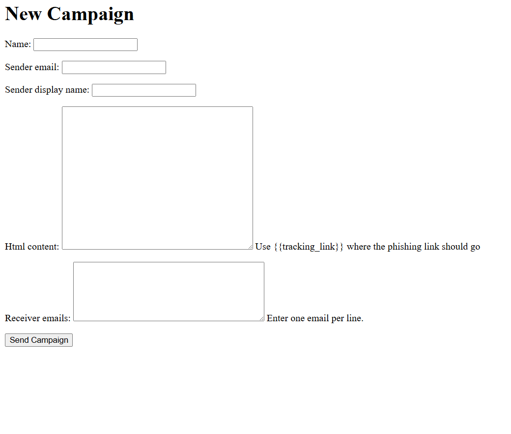
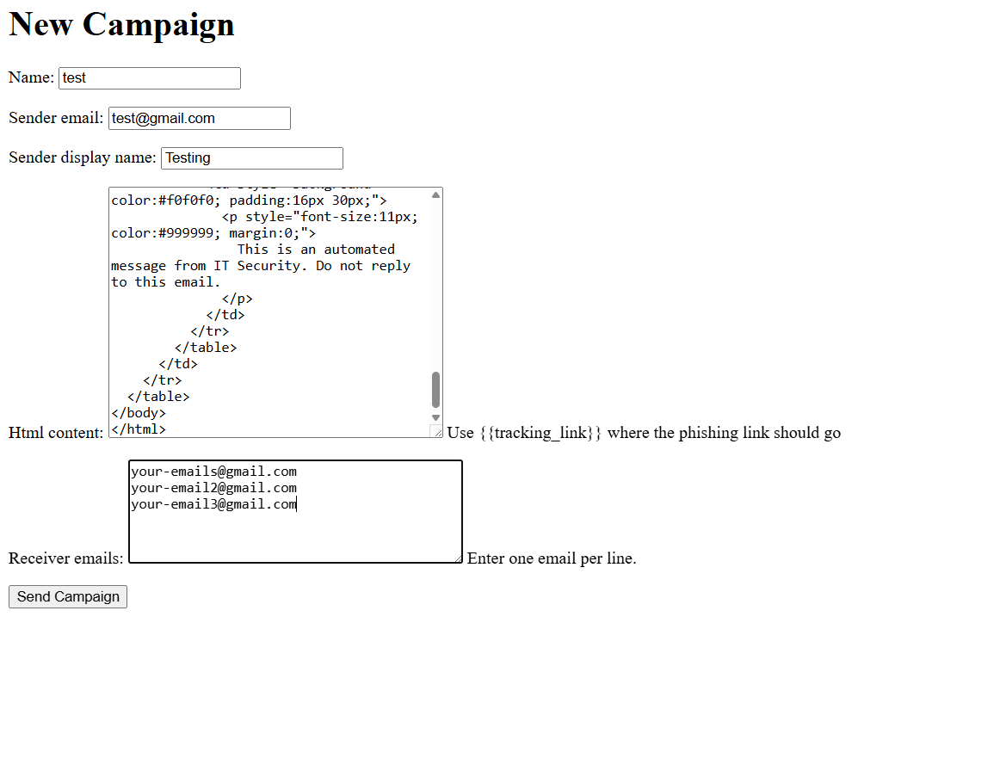
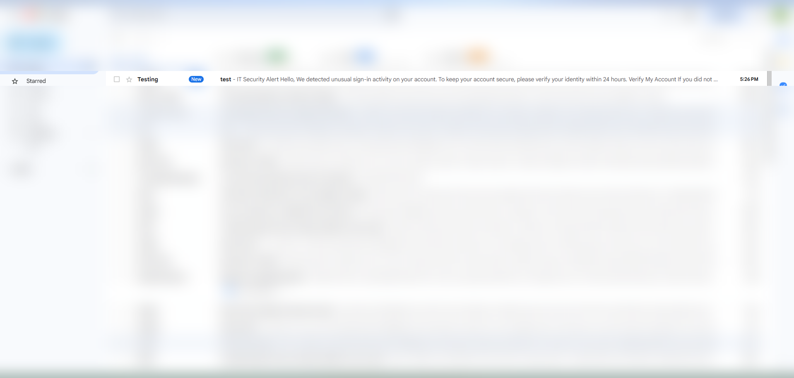
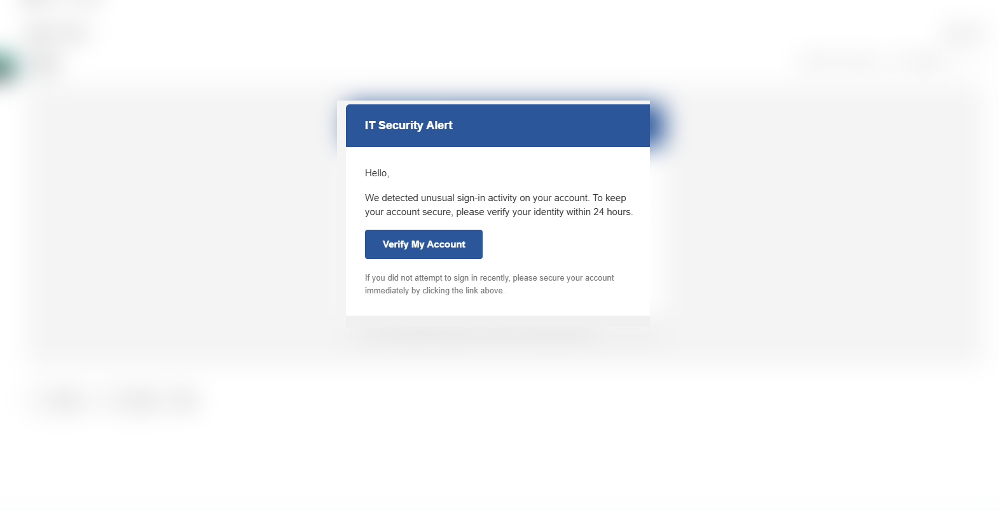
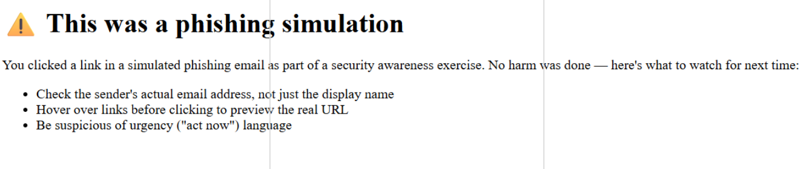
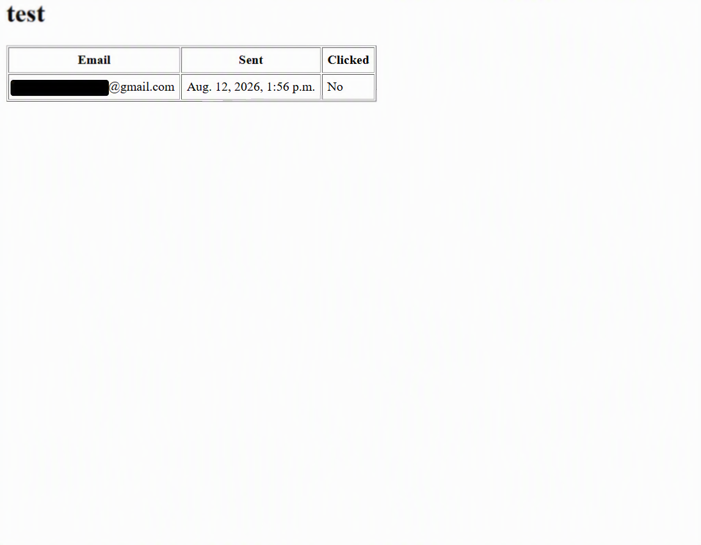

# Phishing Simulator

> ⚠️ **Authorized use only.** This tool is built for internal, sanctioned
> security awareness programs where recipients have consented to
> participate (e.g. via organizational policy). Sending simulated phishing
> emails to people who have not agreed to be part of such a program is
> illegal in most jurisdictions and unethical regardless of intent. This
> project is a portfolio/learning implementation and is not intended for
> production use without further hardening (see Architecture & Security
> Design below).

A lightweight Django application for running authorized phishing awareness
campaigns. Security teams can compose a campaign, send simulated phishing
emails to a list of recipients, and track who clicks the embedded link —
without collecting anything beyond what's needed to identify who should
receive follow-up security training.

## Why

Employee-facing phishing simulations are a standard part of security
awareness programs (similar in spirit to tools like GoPhish). This project
is a from-scratch reimplementation built to explore secure-by-design web
app development: cryptographically secure per-recipient tracking tokens,
hardened Django settings, and a clean separation between the "attack"
surface (email + tracking link) and the reporting dashboard.

## Features
- Create campaigns with a custom sender name/address, subject, and raw HTML body
- Bulk recipient upload
- Unique, unguessable tracking token per recipient (`secrets.token_urlsafe`)
- Click logging with timestamp + IP
- Educational landing page shown immediately after a click
- Campaign results dashboard (sent vs. clicked)

## Screenshots

**1. Campaign creation form**

Create a campaign by specifying a name, sender email/display name, raw HTML
body (with a `{{tracking_link}}` placeholder), and a list of recipients.

**2. Filled campaign example**

Example campaign configured with a spoofed "IT Security" sender identity
and a simulated account-verification email.

**3. Simulated email in the inbox**

The email as delivered to a real Gmail inbox (unrelated inbox contents
blurred for privacy).

**4. Rendered email**

The HTML email as the recipient sees it when opened.

**5. Awareness landing page**

Clicking the link logs the click and immediately redirects to an
educational page explaining the red flags the recipient missed.

**6. Campaign results dashboard**

Per-recipient tracking of send time and click status (recipient email
redacted here for privacy).

## Architecture & Security Design

### Tracking tokens
Each recipient gets a unique token generated with Python's `secrets.token_urlsafe(32)`,
not `uuid4()` or a sequential database ID. `secrets` is drawn from a
cryptographically secure random source, so tokens can't be predicted or
brute-forced. A sequential ID (`/t/104/`) would let anyone iterate through
`/t/105/`, `/t/106/`, etc. and register clicks for recipients who never
actually clicked — corrupting the campaign's data. `uuid4` is also
random but not designed as a security primitive; `secrets` is the
Python standard library's explicit recommendation for tokens, passwords,
and security-sensitive random values.

### Click logging is idempotent
`track_click` only writes `clicked_at` and `ip_address` the first time a
token is visited (`if recipient.clicked_at is None`). This matters for two
reasons: email clients and security scanners sometimes pre-fetch links
automatically, which would otherwise register false "clicks" every time the
email is opened; and it keeps the metric meaningful — "did this person
click" rather than "how many times did something touch this URL."

### Access control
The campaign creation form and results dashboard both require
authentication (`LoginRequiredMixin`). Without this, anyone with a results
URL could see who in an organization clicked a simulated phishing link —
which is itself sensitive data (it identifies individuals who may need
follow-up training) and shouldn't be publicly readable. This was
identified during development and is covered by `AccessControlTests` in
the test suite.

### Sender authenticity
The sender display name and address are configurable, but real deliverability
depends on SPF/DKIM/DMARC records for whatever domain is used to send —
without them, mail providers will typically flag or reject a sender address
that doesn't match the authenticating account. This is intentional: the
project demonstrates campaign mechanics without requiring (or encouraging)
identity spoofing of a domain the operator doesn't control. Production use
would pair this with a dedicated sending domain the awareness-program owner
actually owns.

### What data is collected
Per recipient: email address, send timestamp, click timestamp (first click
only), and IP address at time of click. No credentials, no personal data
beyond what's needed to identify who should receive follow-up training, and
no landing page beyond an educational "you were phished" notice — the tool
never simulates actual credential harvesting.

### Environment-based configuration
Secrets (Django `SECRET_KEY`, email credentials, database URL) are loaded
via `django-environ` from a `.env` file that's excluded from version
control (see `.env.example` for the required variables). Local development
defaults to SQLite; production points `DATABASE_URL` at PostgreSQL with no
code changes required.

## Tech stack
Django · SQLite/PostgreSQL · SMTP (Gmail/SendGrid) · deployed on PythonAnywhere with HTTPS